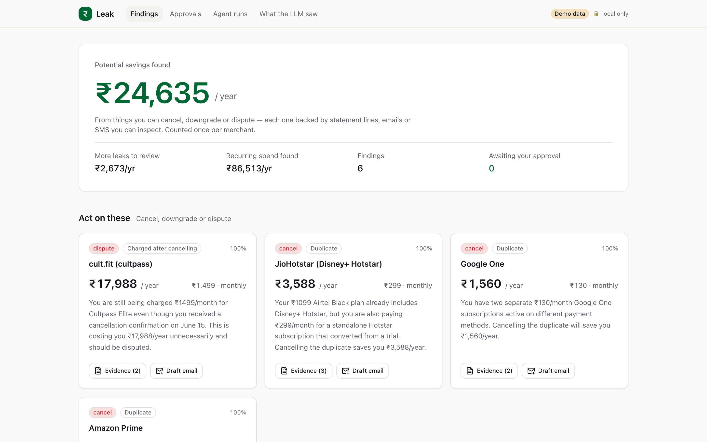
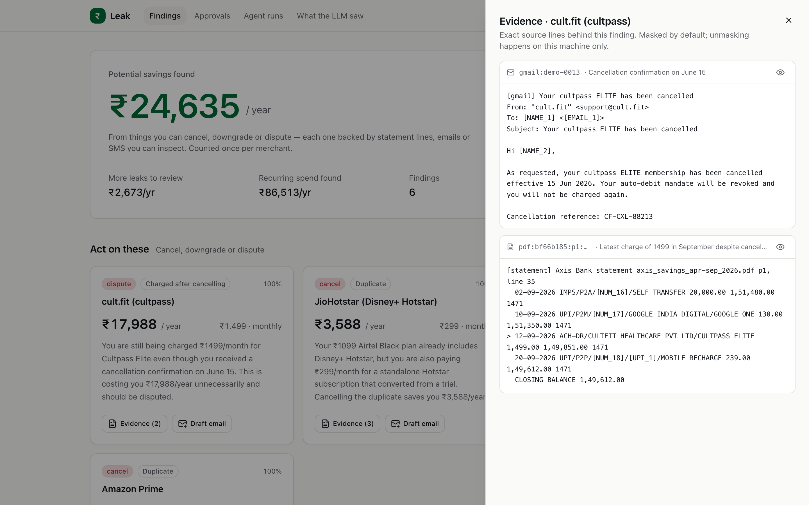
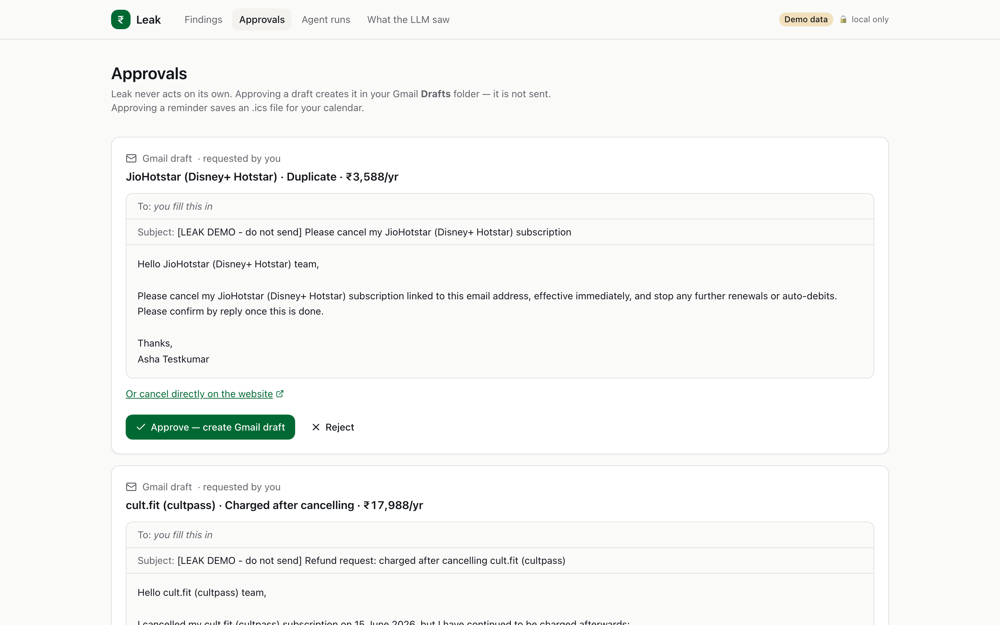
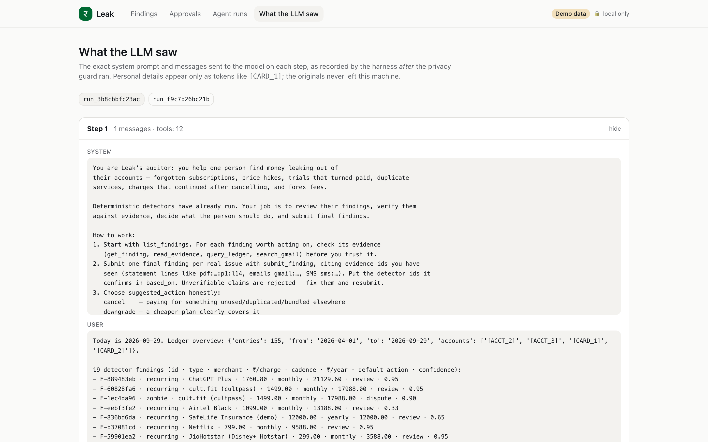
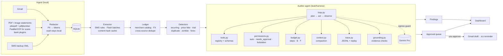

# Leak

**An open-source, local-first AI agent that reads your email, bank statements and SMS alerts, finds the money quietly leaking out — forgotten subscriptions, price hikes, trials that turned paid, duplicates, charges after you cancelled, forex fees — and drafts the cancellation emails for you to approve.**

India-first (₹, HDFC/ICICI/SBI/Axis, UPI autopay, bank SMS), region-agnostic by design. The agent harness is built by hand — no LangChain, LlamaIndex or CrewAI — and is meant to be read.

[](docs/assets/leak-demo.mp4)



<sub>All screenshots and the video use the synthetic demo dataset (made-up persona, accounts and numbers).</sub>

```text
$ uvx leak-audit demo
 1  cult.fit       zombie: charged 3× after you cancelled     ₹17,988/yr   dispute
 2  JioHotstar     duplicate: already in your Airtel Black     ₹3,588/yr   cancel
 3  Google One     duplicate: billed on two accounts           ₹1,560/yr   cancel
 4  Amazon Prime   duplicate: already in your Airtel Black     ₹1,499/yr   cancel
 …  Netflix price hike (+₹1,800/yr), ChatGPT forex fees (₹867/yr), recurring subscriptions to review

₹24,635/year in potential savings — every row cites the statement line, email or SMS behind it.
```

---

## A quick tour

| Findings, with the savings number | Evidence drawer: the exact source lines |
|---|---|
|  |  |
| **Approvals: drafts are queued, never sent** | **What the LLM saw: post-redaction payloads** |
|  |  |

## Privacy & safety

Leak is built on the assumption that your financial data is nobody's business.

- **Local-first.** Everything — documents, ledger, findings, traces — lives in one SQLite file under `.leak/` on your machine. There is no Leak server and no telemetry.
- **Redacted before any LLM sees it.** PAN, Aadhaar (Verhoeff-checked), card numbers (Luhn-checked, full or masked), account numbers, phone numbers, emails, personal UPI IDs, addresses and your own names are replaced with tokens like `[CARD_2]` at ingestion. The token → value map stays in a local vault (`chmod 600`) so *your* dashboard can unmask.
- **Fail-closed egress guard.** Every payload is redacted again and re-scanned right before it leaves the process; if anything still looks like PII, the call is refused. A test plants a tool that leaks raw text on purpose and asserts nothing reaches the model ([`tests/test_privacy_egress.py`](tests/test_privacy_egress.py)).
- **See exactly what the model saw.** The trace records the post-guard payload of every step; the dashboard's *What the LLM saw* page shows it verbatim.
- **No send tool.** The agent can *queue* a Gmail draft or a calendar reminder; nothing happens until you press Approve. There is no code in this repository that sends email. Gmail access is read-only unless you opt in to `gmail.compose` (drafts).
- **Grounded findings only.** A finding is accepted only if every evidence id it cites exists and its amount appears in the cited text.
- **Generated text is untrusted too.** The model read your email, and email can carry prompt injections. Findings whose merchant name or explanation contains personal identifiers or links are rejected, and every draft and reminder is re-checked right before the Gmail call or file write. If anything looks off, the action is blocked, not sent.
- **Bring your own OAuth client.** Leak ships no Google client ID, so no third party ever holds a token to your inbox.
- **Local dashboard hardening.** Binds to `127.0.0.1`, rejects non-localhost `Host` headers (DNS rebinding), sends no CORS headers, and requires a per-process token for approvals and unmasking.

Statements never leave unredacted either: for banks without a parser, Leak sends the *redacted text* of the statement, never the PDF. Scanned (image-only) PDFs are refused rather than uploaded.

## Quickstart

### Try it on synthetic data (one command)

```bash
uvx leak-audit demo
```

(Until the package is on PyPI: clone the repo and run `uv run leak demo`.)

Scans a synthetic inbox, four password-protected bank/card statements and an SMS backup, extracts receipts (replayed from a recorded cassette: ₹0, no key needed), runs the detectors, prints the report and opens the dashboard. With `GEMINI_API_KEY` set, the Pro-model auditor agent also reviews every finding (~₹30).

### Your own data

Gemini is optional. Without `GEMINI_API_KEY` (or with `[llm] provider = "none"`) everything runs on your machine: bank-plugin statement parsing, OCR of scanned PDFs and photos (PaddleOCR, local), SMS rules and the detectors. With a key, Gemini adds email extraction, unknown-bank statements and the auditor agent, and it only ever receives masked text: account and card numbers, names, phones, emails and UPI IDs become tokens like `[ACCT_1]` before anything leaves, and the egress guard refuses to send a payload that still looks like PII. Statement PDFs and images are never uploaded.

Python 3.12 or 3.13 (PaddlePaddle has no wheels for newer versions yet). PaddleOCR downloads its models (~130 MB, to `~/.paddlex`) the first time it reads a scan.

```bash
git clone https://github.com/<you>/leak && cd leak
uv sync
cp config.example.toml config.toml        # model ids, budgets, your names (always masked)
echo 'GEMINI_API_KEY=...' > .env          # https://aistudio.google.com/apikey
(cd web && npm install && npm run build)  # dashboard, once

uv run leak gmail auth                                   # see "Gmail setup" below
uv run leak scan --gmail                                 # add --limit 100 to sample first
uv run leak scan --statements ~/Downloads/statements     # PDFs, scans, photos; passwords: LEAK_PDF_PASSWORDS="a,b" in .env
uv run leak scan --sms ~/Downloads/sms-backup.xml        # Android "SMS Backup & Restore" export
uv run leak extract                                      # Flash: receipts, renewals, price changes (cached)
uv run leak report                                       # detectors + Pro auditor → ranked report
uv run leak serve                                        # dashboard on http://127.0.0.1:8765
```

<details>
<summary><b>Gmail setup (bring your own OAuth client, ~5 minutes)</b></summary>

1. In [Google Cloud Console](https://console.cloud.google.com/) create a project and enable the **Gmail API**.
2. **Google Auth Platform → Branding**: fill in an app name and your email. **Audience**: *External*, keep it in **Testing**, and add your Gmail address under **Test users**. (You do not need Google verification for your own use.)
3. **Clients → Create client → Desktop app**, download the JSON to `~/.config/leak/client_secret.json`.
4. `uv run leak gmail auth`. Google will warn the app is unverified — it's yours; choose *Advanced → Go to …*.
5. To let Leak create drafts, set `[gmail] enable_actions = true` and run `leak gmail auth` again (adds `gmail.compose`).

Testing-mode tokens expire after 7 days; Leak notices and asks you to log in again. Google Workspace users can pick *Internal* instead and skip both the test-user list and the expiry.
</details>

## How the harness works



The whole agent is one loop ([`leak/harness/loop.py`](leak/harness/loop.py)):

```text
while True:
    budget.start_step()                       # step ceiling → BudgetExceeded
    payload = egress_guard(context)           # redact + re-scan; refuse on PII
    trace("llm_request", payload)             # exactly what left the machine
    response = llm.generate(payload, tools)
    budget.charge(response.usage)             # $ / ₹ ceiling → BudgetExceeded
    if not response.tool_calls: return response.text
    for call in response.tool_calls:
        auto           → validate args, run, feed result back
        needs_approval → enqueue for a human, tell the model it did NOT run
        forbidden      → never shown to the model; refused if called anyway
    context.compact()
```

| Component | File | What it teaches |
|---|---|---|
| Loop | [`loop.py`](leak/harness/loop.py) | Plan → tool call → observe; where every safety property is enforced in code |
| Tools | [`tools.py`](leak/harness/tools.py) | A Python function + Pydantic model becomes an LLM tool; JSON schema generated, args validated, errors fed back instead of crashing |
| Permissions | [`permissions.py`](leak/harness/permissions.py) | `auto` / `needs_approval` / `forbidden`; config can tighten, never loosen; approval queue |
| Budget | [`budget.py`](leak/harness/budget.py) | Step + cost ceilings from real token usage (cached tokens priced separately), shown in $ and ₹ |
| Context | [`context.py`](leak/harness/context.py) | What goes into the prompt each step; compaction of old tool output |
| Trace | [`trace.py`](leak/harness/trace.py) | Append-only JSONL flight recorder; `leak trace replay` pretty-prints, `ReplayProvider` re-runs a loop deterministically for $0 |
| Grounding | [`grounding.py`](leak/harness/grounding.py) | Claims must cite evidence that exists and supports them; rejections go back to the model to fix |

`leak/harness/` is 833 lines, 543 of them code — the rest is comments written for whoever reads it next. It has no dependency on Gemini: providers implement a five-line `LLMProvider` protocol ([`leak/llm/provider.py`](leak/llm/provider.py)), and tests run the whole thing against a scripted fake model. `mypy --strict` clean.

Model ids are config, not code (`config.example.toml`): extraction on `gemini-3.5-flash-lite`, the auditor on `gemini-3.1-pro-preview` at the time of writing.

## Evals

`uv run python evals/run_evals.py` — runs offline by replaying a recorded cassette (no key, $0), and in CI on every push.

| Metric | Result | Set |
|---|---|---|
| Extraction F1 (charges, renewals, price changes, cancellations) | **1.000** (42/42, 0 FP) | 22 emails + 21 SMS, labels generated with the data |
| Detection precision / recall | **1.000 / 1.000** | 18 planted findings incl. zombie, trial→paid, bundle duplicate, forex |
| Cross-source dedupe: missed merges | **0** | 155 ledger entries, 27 confirmed by 2–3 sources |
| SMS handled by deterministic rules | 21 / 21 | no LLM call |

| Cost (live Gemini, measured) | Tokens | Cost |
|---|---|---|
| Extraction, first run (22 emails → 3 Flash-Lite calls) | 11.3k in / 7.6k out | **$0.022 · ₹1.96** (≈ ₹0.09/email) |
| Extraction, any re-run | — | **₹0** (content-hash cache) |
| Bank statements (4 PDFs, 153 txns) | — | **₹0** (deterministic parsers) |
| Auditor agent, one `leak report` (20 steps, Pro) | 292k in (67% cached) / 8k out | **$0.33 · ₹29** |

These fixtures are synthetic and small, and were written alongside the parsers and prompt — read the scores as "no regressions", not "works on every inbox". Harder, independently written fixtures are the most valuable contribution you can make; see [`evals/README.md`](evals/README.md).

## Supported sources

| Source | How | Notes |
|---|---|---|
| HDFC Bank savings | parser `hdfc_savings` | direction from running balance |
| Axis Bank savings | parser `axis_savings` | |
| ICICI Bank credit card | parser `icici_credit_card` | foreign-currency column → forex detector |
| SBI Card | parser `sbi_card` | |
| Any other bank | LLM fallback on **redacted** text | rows must cite a line that contains their amount |
| Password-protected PDFs | `pikepdf`, decrypted in memory only | passwords via `LEAK_PDF_PASSWORDS` |
| Gmail | read-only API, incremental sync | drafts only with opt-in `gmail.compose` |
| Android SMS | "SMS Backup & Restore" XML | DLT senders only; OTPs and personal chats dropped before storage |

**Add your bank:** most parsers are ~20 lines — see [`docs/adding-a-bank.md`](docs/adding-a-bank.md). The merchant catalog ([`leak/ledger/merchants.yaml`](leak/ledger/merchants.yaml)) takes PRs too: aliases, typical prices, cancel links, and what telecom/credit-card bundles include.

## CLI

| Command | |
|---|---|
| `leak demo` | Whole pipeline on synthetic data, then the dashboard |
| `leak scan [--gmail] [--statements PATH] [--sms FILE] [--limit N]` | Ingest + redact into the local store |
| `leak extract` | Receipts, renewals, price changes, cancellations → ledger |
| `leak ledger [--merchant netflix]` | The normalized, de-duplicated ledger |
| `leak report [--no-agent]` | Detectors + auditor agent → ranked findings |
| `leak serve` | Dashboard: findings + evidence drawer, approvals, agent runs, what the LLM saw |
| `leak actions list \| approve ID \| reject ID` | The approval queue from the terminal |
| `leak trace list \| replay RUN \| rerun RUN` | Inspect or deterministically re-run any agent run |

## Development

```bash
uv sync && uv run pytest -q          # offline, no API key
uv run ruff check . && uv run mypy leak
uv run python evals/run_evals.py     # add --live to record new model output
(cd web && npm run dev)              # dashboard with hot reload, proxies /api to `leak serve`
(cd video && npm install && npm run shots && npm run render)   # screenshots + Remotion video, see video/README.md
uv run python demo/generate_sample_data.py   # regenerate synthetic data + labels
```

## Roadmap

- **Account Aggregator** (RBI AA framework) as a consented, structured alternative to PDFs and SMS
- **More banks**: Kotak, Yes, IDFC FIRST, IndusInd, AU, HSBC, Amex India, OneCard; Paytm/PhonePe wallet exports
- **Ollama-only mode**: same `LLMProvider` protocol, fully offline extraction and auditing
- **WhatsApp / Telegram bot** for the monthly "here's what leaked" summary and one-tap approvals
- **"Unused" detector**: no product-usage emails in 90 days for a paid service
- Encrypted vault (OS keychain), UPI mandate list import

## License

MIT — see [LICENSE](LICENSE). Security reports: [SECURITY.md](SECURITY.md).
